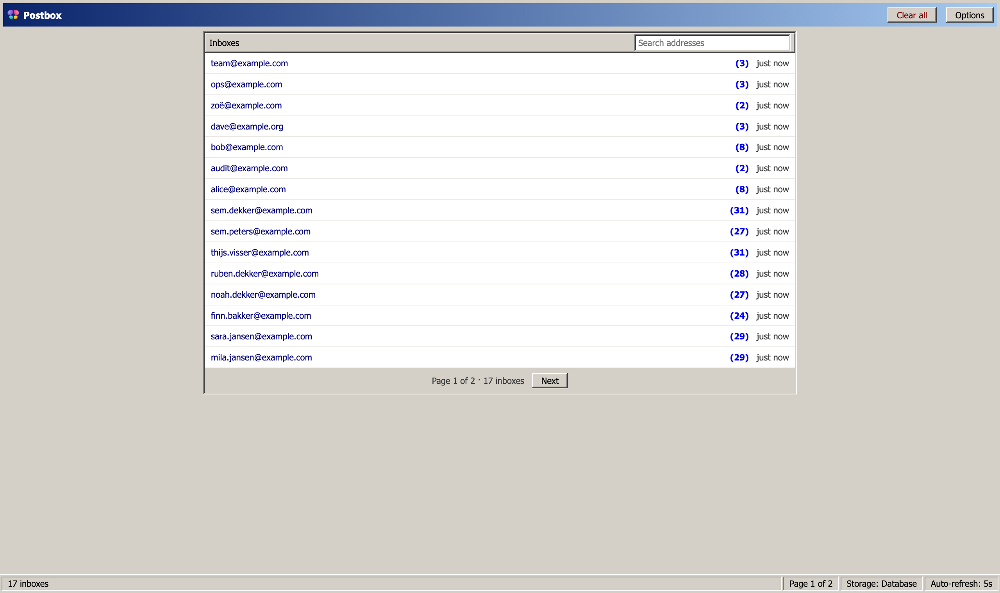
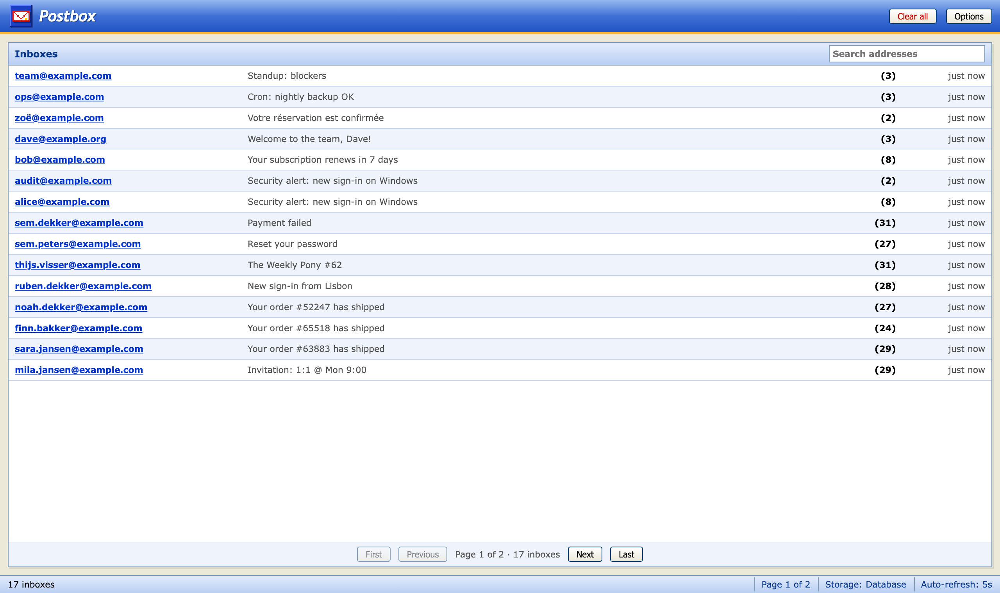

The pages load their assets through ``. All of them ship with the package, so nothing comes from a CDN and there is no build step:

- `postbox/postbox.css`: layout and structure only, plus CSS variables with plain defaults
- `postbox/themes/<POSTBOX_THEME>.css`: the look. Bundled: `mail2003` (default, webmail circa 2003) and `mail2000` (classic 2000 desktop)
- `postbox/htmx.min.js`

## Themes

A theme is one stylesheet that overrides the variables from `postbox.css` (`--pb-bg`, `--pb-accent`, `--pb-font`, ...) and adds its own skin on top of the same class names. To add one, put `postbox/themes/<name>.css` in any static folder and set:

```python
POSTBOX_THEME = "<name>"
```

`POSTBOX_THEME = None` gives the plain base without a theme.

Every viewer can pick their own theme under **Options** (top right). The choice is kept in a `postbox_theme` cookie, scoped to the inbox URL, and rendered server side in `<head>`, so pages never flash in the wrong theme. `POSTBOX_THEME` stays the default for everyone who has not chosen. The Options page also shows the Postbox, Django and Python versions and the storage in use.

| `mail2000` | `mail2003` |
| --- | --- |
|  |  |

## Screenshots

`make screenshots` runs `scripts/screenshots.py`: it fills a throwaway in-memory database with the demo mails, renders every page in both themes and saves them with headless Chrome into `docs/img/`. It also copies the logo to `public/logo.svg` and `public/favicon.svg`, which dokk uses for the docs site. Set `CHROME=/path/to/chrome` if Chrome is not found.

If your project already loads htmx, set `POSTBOX_LOAD_HTMX = False` and add it yourself in an overridden `postbox/base.html` (``).

## Updating htmx

```bash
make htmx
```

This runs `scripts/update_htmx.py`, which downloads the latest htmx release from npm into `src/django_postbox/static/postbox/htmx.min.js`. Commit the result.

## How the pages use htmx

- `hx-boost` on the body makes links and forms swap the page without a reload.
- The inbox list and the overview poll every five seconds and only swap themselves (`hx-select`).
- The HTML body is rendered in `<iframe sandbox srcdoc>`: no scripts, and neither postbox's CSS nor the mail's CSS leaks across. A CSP in the mail's head only lets images, styles and fonts load, and links open in a new tab.
